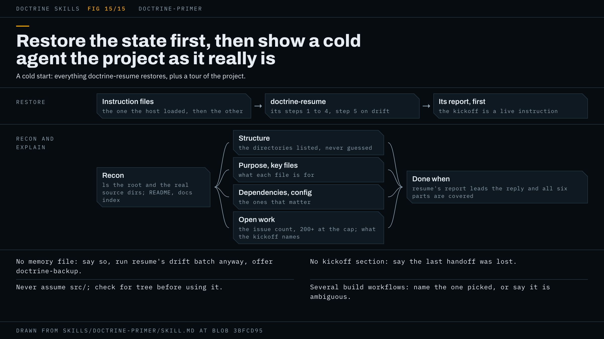

# doctrine-primer

Use it when an agent starts cold in a repo: it restores the last session's state exactly as `doctrine-resume` does, then explains the project to an agent that has never seen it.



The figure shows the three steps this page walks through: restore, recon, explain.

## When to use it, and when not

The trigger is a cold start: a fresh session in a repo, a request to prime, orient or give a situation report, or an agent that has never seen this repo.

When you need state only and not a tour of the code, `doctrine-resume` is the cheaper path, and the primer says so and stops. The two point at each other: the resume skill sends you to the primer when the agent needs the project explained.

The primer is not one of the hub's nine wrappers. The hub groups it with `doctrine-backup`, `doctrine-handoff` and `doctrine-resume`, the skills that carry a session's state and handoff to the next (doctrine step 5). It does not run a gate of its own. No hook types it: the auto-cycle types the `doctrine-resume` command after a `/clear`, never this one.

## What it asks you

The primer asks nothing of its own. Two questions can reach you through the resume steps it runs:

- Where the memory file and the repo disagree and auto-cycle is off: "Memory is stale — resync it?" On yes it runs `doctrine-backup`.
- Where the handoff's first action may already have run and no phase record was read: whether it ran.

Where no memory file exists, it offers `doctrine-backup` at the end of the session.

## How the work runs

Before step 1 it reads the project instruction files. Your host loads one for it, and the hub's host reference names which: Claude Code loads `CLAUDE.md`, and Codex loads `AGENTS.md`. The primer reads the other one too where it exists, and reads the loaded one itself where the host stopped short of its end. `AGENTS.md` is usually where a project keeps its issue-tracking and session-completion norms.

1. **Restore.** It loads `doctrine-resume` first and makes no other call before it, because resume decides what has to come before the phase's wrapper. It then runs resume's steps 1 to 4: read the memory file, act on the kickoff's first line, check drift, hydrate the Active Work table, and write resume's report. That report goes at the very top of the reply, since its kickoff is a live instruction from the previous session and not history. Where resume finds drift or a backup that never landed, the primer takes resume's step 5 as resume writes it. Resume's step 6, which carries a phase on in the same turn under auto-cycle, is not among the steps the primer names.

   Through those steps, when the record the current handoff names is Open or Blocked, the session loads that phase's wrapper and then the `doctrine` skill. Two cases differ from a plain resume. With no memory file, resume would stop; the primer says there is none, offers `doctrine-backup` for the end of the session, runs resume's drift batch anyway for the branch, uncommitted work, open PRs and the build, and goes on to recon. With a memory file that has no `## Next Session Kickoff` section, it says so plainly: `doctrine-backup` is required to write that section, so its absence means the last handoff was lost.

2. **Recon.** It finds the project's real shape and never assumes a `src/` directory. In one batch:

   - `ls` the root, then `ls` the two or three real source directories that listing shows.
   - `command -v tree` before using a tree, since many hosts lack it.
   - `gh issue list --state open --limit 200 --json number --jq 'length'` for the open issue count, reported as "200+" when it returns 200, because the limit caps the fetch. It pulls titles only for the few issues the kickoff names, since some repos carry thousands.

   Then it reads `README.md` if one exists and any index under `docs/`: the README is usually the product, the docs index the engineering map. Where the repo has several plausible build workflows, it names the one resume's drift check picked and says the build verdict rests on that pick, or says the choice is ambiguous. A guess never becomes a silent "built ✓".

3. **Explain.** It covers six things:

   - Structure: the directories it actually listed, never a guessed layout.
   - Purpose and goals.
   - Key files, and what each is for.
   - Important dependencies.
   - Important configuration files.
   - Open work: the issue count from recon, and whatever the kickoff points at.

## How it ends

It is done when resume's report leads the reply, with the kickoff quoted or its absence flagged, and all six parts of the explanation are covered. The primer writes no file of its own. A file changes only through the resume steps it runs: `doctrine-backup` when you say yes to a resync or a backup never landed, and one paused line appended to the phase record when the first action is ambiguous.

## How to invoke it

The description fires on a cold start or a request to orient. Sample prompts:

```text
prime
```

```text
give me a situation report on this repo
```

## Requirements

Nothing beyond the plugin must be installed. The GitHub CLI `gh` supplies the open PRs, the build status and the issue count. Where `gh` fails, resume's drift check says so once and continues on git alone. Install commands for the plugin's optional pieces are in [docs/requirements.md](../requirements.md).

The hub's page is [doctrine.md](doctrine.md), and the README is [here](../../README.md).

The specification is [`skills/doctrine-primer/SKILL.md`](../../skills/doctrine-primer/SKILL.md), and the restore steps it runs are in [`skills/doctrine-resume/SKILL.md`](../../skills/doctrine-resume/SKILL.md); trust them over this page wherever they disagree.
