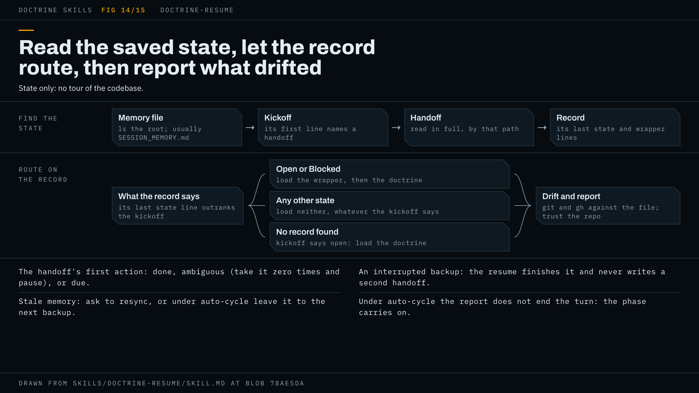

# doctrine-resume

doctrine-resume picks up where the last session stopped. It reads the session memory file the last session left, follows its kickoff to the handoff and the phase record, and reports where the repository has drifted from what the file says. It restores state only and gives no tour of the codebase. It is not a wrapper: it loads the doctrine only for a phase that is still open.

Its inputs come from other doctrine skills. `doctrine-backup` writes the memory file and its Next Session Kickoff, and `doctrine-handoff` writes the handoff the kickoff names. The handoff points at the phase's record, a file the doctrine phase keeps, whose last `State:` line says whether the phase is still open.



## When to use it

Ask it to load memory, resume the session, restore state, or pick up where the last session left off. Use it after a `/clear`, or in a new session in a repo where `doctrine-backup` saved a memory file. If you have never worked in the repo, or the agent needs the project explained, use `doctrine-primer` instead.

You may not have to ask. When auto-cycle is on for a phase (see [Auto-cycle](#auto-cycle) below), the plugin clears the session itself and types `/doctrine:doctrine-resume (typed by doctrine auto-cycle, not a ruling)` into it (on Codex, `$doctrine:doctrine-resume` with the same words). The words in parentheses tell the new session the line is the plugin's, not your ruling.

## What it asks you

Usually nothing. It asks in two cases only:

- The memory file and the repository disagree, auto-cycle is off, and the cause is not an interrupted backup (step 4 below finishes that one without asking). It asks "Memory is stale — resync it?" and runs `doctrine-backup` if you say yes.
- The handoff's first action may already have run, and there is no record to pause in. It asks you whether it ran.

If no memory file exists, it says so and stops, and points you at `doctrine-primer`.

## How it runs

**1. Find the saved state.** It lists the repository root before reading anything, because the file is not always called `SESSION_MEMORY.md`. If there are several, it reads the one with the plain name and names the others; it never merges them. It reads every section, Gotchas included, because a later `doctrine-backup` carries forward only what it was told.

**2. Follow the kickoff to the record.** The kickoff's first line names a handoff. It reads that file in full, by that path, and never the newest file in `docs/handoffs/`. It then reads the record the handoff's `record:` line names, trying the path as written if absolute, then relative to the repo root, then relative to the root's parent, which is where a sibling repo's record lands. From the record it takes the last `State:` line and the last `wrapper:` line, falling back to the handoff header's `wrapper:` line.

The record decides; the kickoff does not. If the record reads Open or Blocked and the kickoff does not say `open`, or the other way round, the report names the mismatch. Facts the restore hook placed in the session are a hint and never outrank the record.

Where the memory file's kickoff and the handoff disagree, the memory file is current and the handoff is history, and the report says so. A kickoff whose first line names no handoff predates the convention that it names one: the report quotes it as it is and says the line is missing. A named handoff that is not on disk is drift.

**3. Load the skills the record calls for.** This happens before any drift check, `git`, `gh` or other file read:

| The record's last state line | What it loads |
|---|---|
| Open or Blocked | `doctrine:<wrapper>`, then `doctrine:doctrine` unless the wrapper already loaded it. With `wrapper: none`, or no wrapper line, only `doctrine:doctrine`. |
| Exited, Stopped, Shipped, Unable, or no state line | Nothing, whatever the kickoff says. |
| No record read (the handoff names none, or its path resolves nowhere) | `doctrine:doctrine` when the kickoff's `state:` is `open`; otherwise nothing. |

A Blocked record also puts its open question in the report: the last `question: <id> opened` line with no later answer, or the state line's own text. A skill that is not installed is named in the report, and the run continues; the handoff's Suggested skills section says what to load instead.

**4. Check for an interrupted backup.** It treats the backup that should have carried the handoff as interrupted when the memory file is tracked and its kickoff names a different handoff than the committed copy does, when the file is untracked and not ignored, or when a newer handoff names this one in its `supersedes:` line. In that last case the newer handoff is the one it follows from then on, and it re-runs the record read and the skill loads on it. The report says `interrupted: handoff written, backup not committed`, and the resume finishes that backup itself, without asking, under `doctrine-backup`'s rules, which commit only files that are not git-ignored. In a public repo `docs/handoffs/` is ignored, so the handoff stays local. It never writes a second handoff for it.

**5. Settle the handoff's first action.** Section 5 of a handoff, Do this first, is one action. Before anyone takes it, the resume decides which of three it is:

- **Done:** the memory file's Resume or the record says it ran. Nobody takes it again.
- **Ambiguous:** nothing says it ran, but its effect is visible (the commit, the file, or the check's result file exists). It is taken zero times. The resume appends `auto-cycle paused: first action ambiguous: <the sentence>` to the record and ends its turn after the report. With no record, it asks you instead.
- **Due:** anything else.

**6. Check drift.** It compares the file with what the repository shows, and trusts the repository:

```text
git status -sb
git status --short | grep -v '^??'
git log --oneline -5
gh pr list --state open
gh workflow list
gh run list --workflow "<name>" --limit 3 --json headSha,conclusion
```

Each mismatch is named exactly, for example "memory says `4b172f9b`, HEAD is `8b36d9f7`". If `gh` fails, it says so once and continues with git alone. An empty workflow list means the repo has no CI, not a failed build, and an empty conclusion is reported as running. A green build usually means artifacts were published, not deployed, so a "deployed" claim stays unverified unless the repo documents a deploy check and the resume runs it. The backup's own `docs(session):` commit, one past the SHA the file records, is not drift.

**7. Hydrate active work.** In the Active Work table it looks up only cells holding a bare issue number, with `gh issue view`. It skips placeholders, cells with several ids, ids from a retired tracker (reported as unhydratable, with a suggestion to migrate them) and references to another repo, and says what it skipped. An issue the file calls open and GitHub calls closed is drift.

**8. Report.** The report has a fixed shape:

```text
## Session Restored

**Resume**: [the file's Resume, verbatim]

**Kickoff**: [the file's Next Session Kickoff, verbatim, or "absent"]

**Handoff**: [path read | none named | named but missing] · record [path and last state line | none named | not found] · doctrine [invoked, with the skills | not open | not installed] [· mismatch with the kickoff's state] [· open question] [· interrupted: handoff written, backup not committed] [· first action: done | ambiguous, paused | due]

**Drift**: ✅ none | ⚠️ [one mismatch per line]

**Active Work** (hydrated):
| Item | Issue | State | Key Files |
```

Nothing is added to it, the Resume and Kickoff are quoted whole, however long, and the file's Key Files column is carried through unchanged. The Gotchas are read but echoed only if you ask.

## Auto-cycle

Auto-cycle is a doctrine feature for long phases: when the context gauge, a hook that reads how much of the session's context is used, warns that it is running low, the session writes a handoff, and the plugin then clears the session and resumes it in place. It is off by default. A phase switches it on by appending `auto-cycle: on cap <n> tier <tokens or percent>` to its record and then running `doctrine-handoff`, so the kickoff chain reaches that record. `cap` limits how many times it cycles, and `tier` is the context use at which the gauge warns. A bare `auto-cycle: on` line does nothing. Auto-cycle is on when the record's last on or off line is an on line, its last state line reads Open or Blocked, and no `.doctrine/auto-cycle.stop` file exists in the session's repo or the record's repo. Under auto-cycle the resume changes in two ways:

- It never asks the stale-memory question. It names the drift in the report and in one line of the record, and leaves the resync to the next backup the cycle runs.
- The report does not end the turn. It carries the phase on under the wrapper it loaded: it takes the first action if it is due, and otherwise continues from where the record and the handoff say the phase stands. It stops only where a rule already stops the run: an ambiguous first action, a Blocked record, the doctrine's own pauses and context warning, or where `doctrine-backup` ends the turn.

## The restore hook

After any `/clear`, with or without auto-cycle, the restore hook `hooks/dctr-restore.mjs` runs first. It follows the same chain, but only from a file named exactly `SESSION_MEMORY.md` at the project root: a memory file under any other name gets no restore facts, though the resume itself still finds it. When the record's last state line reads Open or Blocked it gives the new session the phase name, the record's path, that state line, the wrapper and the current handoff, in under 2,000 characters. It needs nothing extra on Claude Code.

## How it ends

It is done when every drift check has run, every bare issue number is hydrated and every skipped cell named, the kickoff is quoted or flagged absent, the kickoff's first line was acted on before any drift check, and, under auto-cycle, the phase was carried on or stopped where a rule says. With auto-cycle off, the turn ends at the report, and a due first action waits for you.

## How to invoke it

```text
/doctrine:doctrine-resume
```

On Codex the command is `$doctrine:doctrine-resume`. Or in plain words:

```text
resume the session
```

## Requirements

A session memory file at the repo root, normally the one `doctrine-backup` writes. `git`. The GitHub CLI `gh` for pull requests, CI runs and issues; without it the resume reports git-only drift and says so.

The resume itself needs nothing more. Auto-cycle, which clears the session and types the resume line for you, needs herdr on both hosts, with the session running in a herdr pane; outside one the cycle pauses instead of clearing. On Claude Code it also needs the one-time setup [docs/requirements.md](../requirements.md#auto-cycle-setup) gives: herdr's Claude integration, auto-compaction off, and the statusline bridge. On Codex the restore hook and auto-cycle run once the doctrine hooks are installed ([the README's Install section](../../README.md#install) gives the command, under Codex CLI). Codex cannot turn automatic compaction off, so there the `tier` on the record's `auto-cycle: on` line must be low enough that the gauge warns before Codex compacts.

The specification is [`skills/doctrine-resume/SKILL.md`](../../skills/doctrine-resume/SKILL.md); trust it over this page wherever the two disagree.
